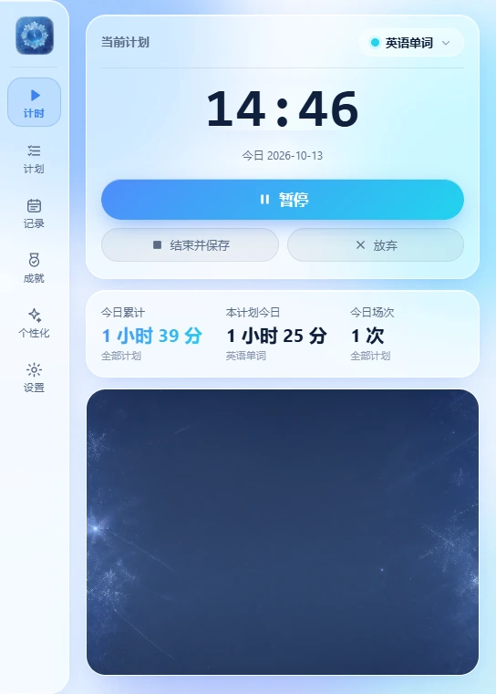
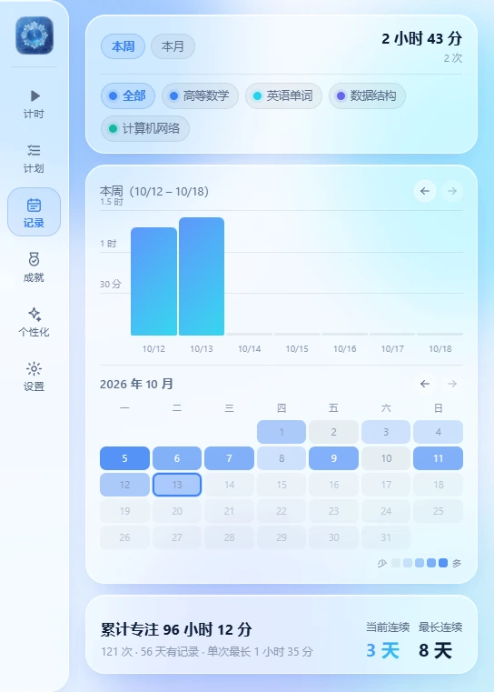
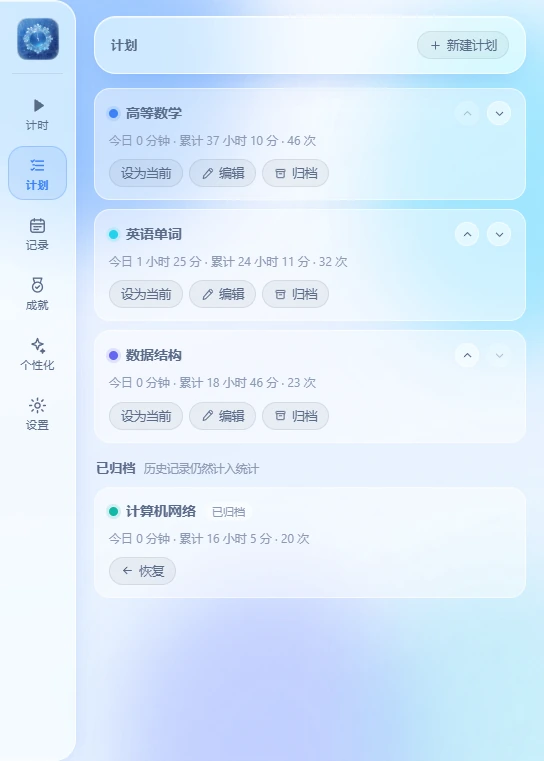
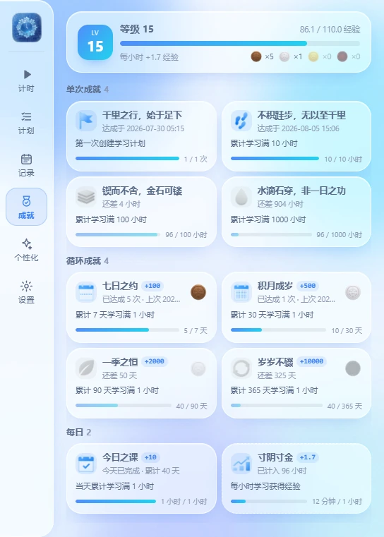
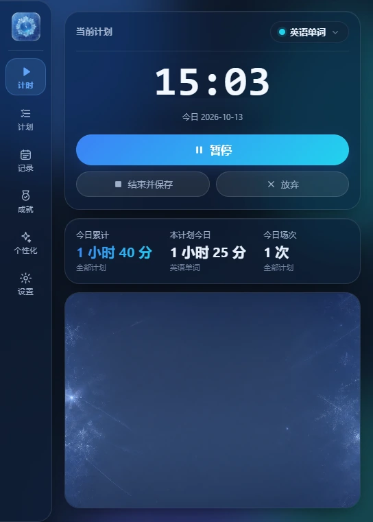

# 孤雪凝时

一款 Windows 桌面端的学习计时器。先建计划，再对着计划正计时，记录自动汇总成柱状图、
热力图与成就。它刻意**不打断你**：没有到点弹窗，没有任何联网请求，关掉窗口就安静地待在托盘里。

[](https://github.com/QQ510447097/GuXueTimer/releases)
[](https://github.com/QQ510447097/GuXueTimer#%E7%B3%BB%E7%BB%9F%E8%A6%81%E6%B1%82)
[](https://github.com/QQ510447097/GuXueTimer#%E5%8F%82%E4%B8%8E%E5%BC%80%E5%8F%91)
[](https://github.com/QQ510447097/GuXueTimer#%E6%95%B0%E6%8D%AE%E4%B8%8E%E9%9A%90%E7%A7%81)
[](LICENSE)



## 这是什么

给"想安静坐一会儿"的人做的计时器。你只需要在建好的计划上按一下开始，
剩下的——今天学了多久、这一周各科怎么分配、连续坚持了几天——都由它自己算。

数据全部落在本机的一个 SQLite 文件里；应用运行期不发起任何网络请求，
不需要账号，也没有遥测。

## 功能

- **计划**：新建 / 改名 / 换色 / 排序 / 归档。每一段时间都明确归属到某个计划上。
- **正计时**：开始 / 暂停 / 继续 / 结束并保存 / 放弃。暂停的区间不计入时长；
  计时中途换计划时，正在走的这一段的**归属不会丢**——它会先结算给原来那个计划。
- **记录与统计**：本周 / 本月柱状图（周模式可以往前翻周）+ 当月热力图日历，
  可按计划筛选；下方是累计时长、场次、有记录的天数、当前与最长连续天数。
- **成就与等级**：单次 / 循环 / 每日三组成就，配等级与经验。循环成就按"累计达标天数"
  反复达成，每次发一枚铜 / 银 / 金 / 红宝石勋章，勋章会永久抬高每小时的收益。
- **个性化**：浅色 / 深色 / 跟随系统；计时页最下方那块可以留空，也可以放一张你喜欢的图。
- **托盘与单实例**：点 × 只是隐藏到托盘（计时继续跑），托盘提示里带当前计划与今日累计；
  重复启动只会把已有窗口叫回来。

**不做的事**（有意留白）：番茄钟、到点提醒、手动补录记录、每日目标、数据导出、
开机自启、云同步。这个工具要的是"安静地记时间"，不是"到点喊你"。

## 下载

到 [Releases](https://github.com/QQ510447097/GuXueTimer/releases) 下载，两种形式：

| | 适合谁 | 说明 |
|---|---|---|
| **便携版 zip** | 大多数人 | 解压后双击 `GuXueTimer.exe` 就能用。不写注册表，不需要管理员权限，删掉文件夹即卸载 |
| **安装包 Setup.exe** | 想要开始菜单 / 卸载项的人 | 按用户安装，不弹 UAC；系统里缺 WebView2 运行时会自动补装 |

> [!IMPORTANT]
> **首次运行，Windows 可能提示「已保护你的电脑」**——因为这个程序没有购买代码签名
> 证书。点「更多信息」→「仍要运行」即可。不放心可以核对 Release 里附的校验和文件。

## 系统要求

- Windows 10 / 11（64 位）
- **Microsoft Edge WebView2 运行时**：Win11 自带；Win10 通常随 Edge 一起装好了。
  如果启动后窗口是空白的，去[微软官网](https://developer.microsoft.com/microsoft-edge/webview2/)
  装一次运行时即可（安装包会自动处理这一步）。
- 磁盘占用约 20 MB，外加你自己的记录文件（很小）

## 数据与隐私

- 全部数据都在 `%LOCALAPPDATA%\GuXueTimer`：
  `timer.db`（SQLite，所有记录与设置）、`background.png`（你选的图）、`app.log`（日志）
- **没有网络请求**，没有账号，没有遥测；断网与联网用起来一模一样
- **备份** = 复制这个目录；**换电脑** = 把它拷过去
- **彻底删除** = 卸载（或删掉 exe）+ 删掉这个目录

## 截图

| 记录与统计 | 计划 |
|---|---|
|  |  |
| **成就与等级** | **深色主题** |
|  |  |

## 常见问题

**点了关闭，程序还在跑？**
那是设计：× 只是隐藏到托盘，计时继续。要真正结束，右键托盘图标 →「退出」。
不喜欢这个行为可以在「设置 → 关闭窗口时最小化到托盘」关掉。

**挂着计时去睡觉了，会算进去吗？**
不会。系统休眠或合盖过夜的那段时间会被剔除，只记你真正坐在前面的时间。

**学习中途换计划，刚才那段时间算谁的？**
算给原来那个计划——切换时会自动结算，不需要你先手动结束一次。

**记录能导出吗？**
暂时没有导出功能。但数据本身就是一个标准 SQLite 文件
（`%LOCALAPPDATA%\GuXueTimer\timer.db`），任何 SQLite 工具都能直接读。

**有手机版 / 网页版吗？**
没有，也不打算有。这个工具的价值恰恰在"桌面托盘 + 数据只在本机"。

## 参与开发

技术栈：**Go + [Wails v3](https://v3.wails.io/) + Vue 3 + Naive UI + SQLite**
（`modernc.org/sqlite` 纯 Go 驱动，不需要 CGO）。

```bash
wails3 dev                              # 开发模式：前端热更新 + Go 改动自动重建
wails3 build                            # 构建 → bin/GuXueTimer.exe
go test ./internal/... .                # 单元测试与集成测试
powershell tools\smoke_test.ps1 -Force  # 端到端冒烟（会清空数据目录，先备份！）
```

架构、数据模型与迁移、恢复策略、测试与打包流程、以及一路上的设计取舍，
都在 **[docs/DEVELOPMENT.md](docs/DEVELOPMENT.md)**。

## 反馈

提 [Issue](https://github.com/QQ510447097/GuXueTimer/issues) 就行。
报 bug 时附上 `%LOCALAPPDATA%\GuXueTimer\app.log` 会快很多。

## 许可

[MIT](LICENSE) © 2026 GuDuXue
